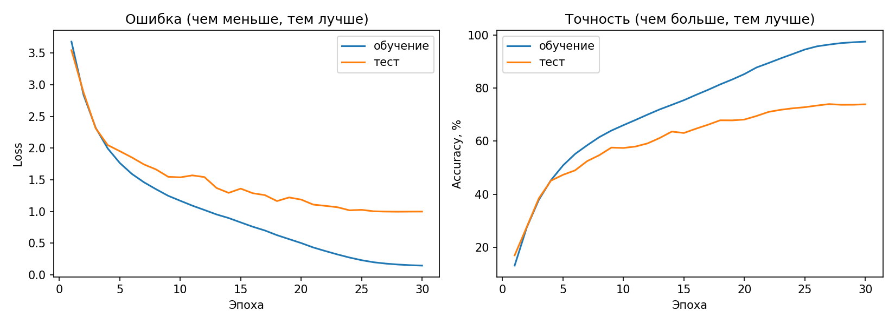
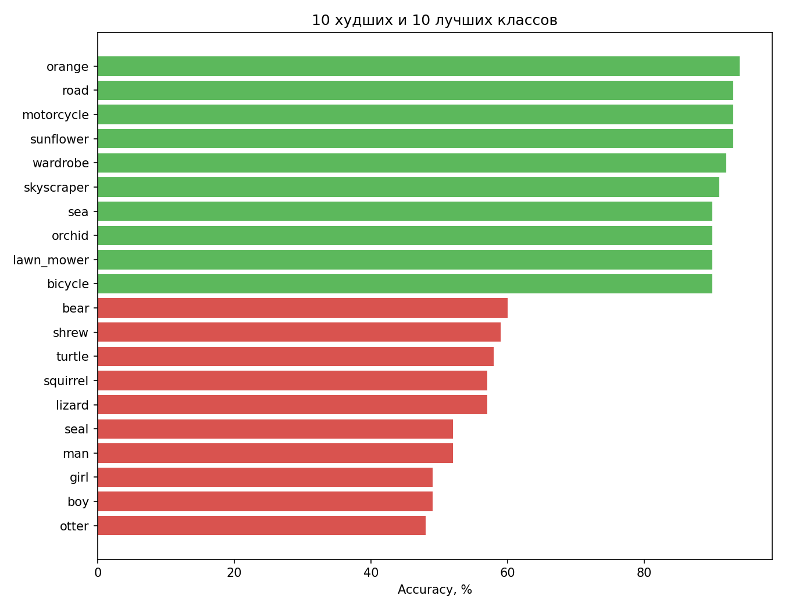

\# CIFAR-100 Classifier


Классификация изображений из набора CIFAR-100 (100 классов, картинки 32×32) на PyTorch.

Проект сделан с нуля: загрузка данных, модель, обучение, оценка и предсказание на своих фото.


## Результаты

| Модель | Top-1 accuracy | Top-5 accuracy |
|---|---|---|
| SimpleCNN (20 эпох, CPU) | 63.65% | 88.62% |
| SmallResNet (30 эпох, GPU T4) | **73.97%** | **93.07%** |

Случайное угадывание дало бы 1%.

### SmallResNet



SmallResNet точнее SimpleCNN примерно на 10 пунктов. Но модель заметно переобучается:
97.5% на обучении против 73.9% на тесте. Следующий шаг: более сильные аугментации
(Cutout, MixUp).

Типичные ошибки: люди разного возраста и пола (man → boy, girl → woman),
деревья (maple_tree → oak_tree) и похожие предметы (plate → bowl).

\### Кривые обучения

!\[Кривые обучения](assets/curves\_simple.png)


Точность на обучении и на тесте почти совпадает, значит, сильного переобучения нет.


\### Лучшие и худшие классы

!\[Точность по классам](assets/class\_accuracy\_simple.png)


Лучше всего модель узнаёт предметы с чёткой формой или цветом (road, motorcycle, sunflower).

Хуже всего: lizard, otter, seal, girl, man.


\### Типичные ошибки

!\[Ошибки](assets/mistakes\_simple.png)


Модель путает визуально похожие классы:

\- люди разного возраста и пола (girl → woman, boy → baby)

\- деревья (maple\_tree → oak\_tree)

\- морские животные (seal → otter, ray → shark)


\## Структура проекта


```

src/

├── dataset.py       # загрузка данных, нормализация, аугментации

├── model.py         # SimpleCNN и SmallResNet

├── train.py         # обучение

├── evaluate.py      # метрики, графики, анализ ошибок

├── predict.py       # предсказание для своей картинки

└── show\_samples.py  # просмотр примеров из датасета

```


\## Установка


```bash

git clone https://github.com/om-mmdv/cifar100-classifier.git

cd cifar100-classifier

python -m venv venv

venv\\Scripts\\activate        # Windows

source venv/bin/activate     # Linux / macOS

pip install -r requirements.txt

```


\## Использование


```bash

\# Обучение (данные скачаются автоматически)

python -m src.train --model simple --epochs 20


\# Оценка

python -m src.evaluate --model simple


\# Предсказание для своей картинки

python -m src.predict photo.jpg --model simple

```


Пример вывода `predict`:

```

&#x20; 1. apple            51.3%

&#x20; 2. sweet\_pepper     48.6%

```


\## Как это работает


\- \*\*Данные:\*\* 50 000 картинок для обучения, 10 000 для теста. Аугментации (случайная обрезка и отражение) применяются только к обучающим данным.

\- \*\*Модель:\*\* SimpleCNN, три группы свёрточных блоков (64, 128, 256 фильтров) с BatchNorm, MaxPool и Dropout.

\- \*\*Обучение:\*\* SGD с momentum, CrossEntropyLoss, косинусное снижение learning rate.


\## Ограничения


Модель знает только 100 классов CIFAR-100. Если показать ей другой предмет, она всё равно выберет один из этих классов.

Картинки сжимаются до 32×32, поэтому мелкие детали теряются.

Веса модели в репозиторий не включены, их можно получить обучением (примерно 2 часа на процессоре).


\## Возможные улучшения


\- Обучить SmallResNet (уже есть в `model.py`) на GPU, например в Google Colab

\- Добавить более сильные аугментации (Cutout, MixUp)

\- Сравнить модели в таблице результатов

