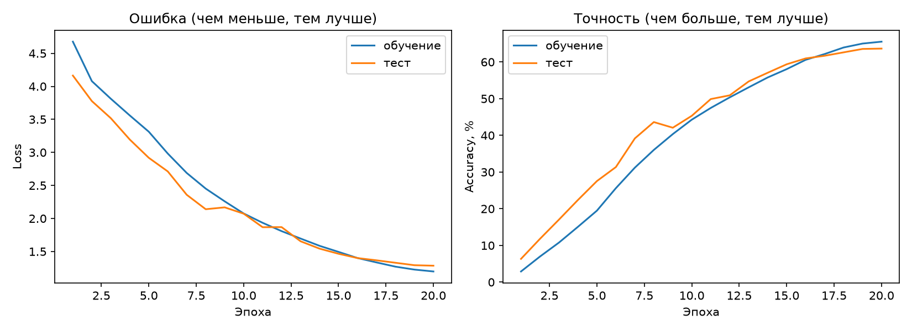
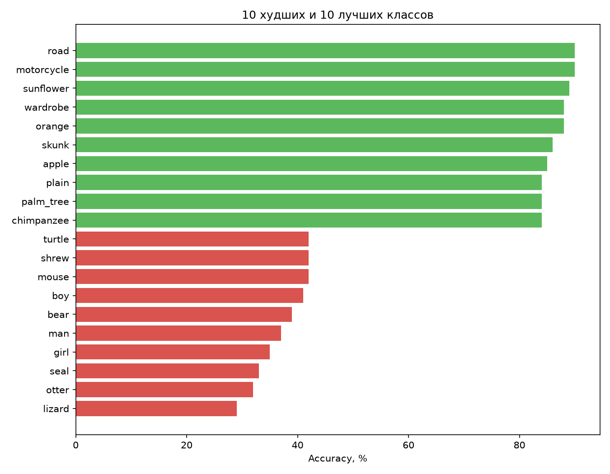
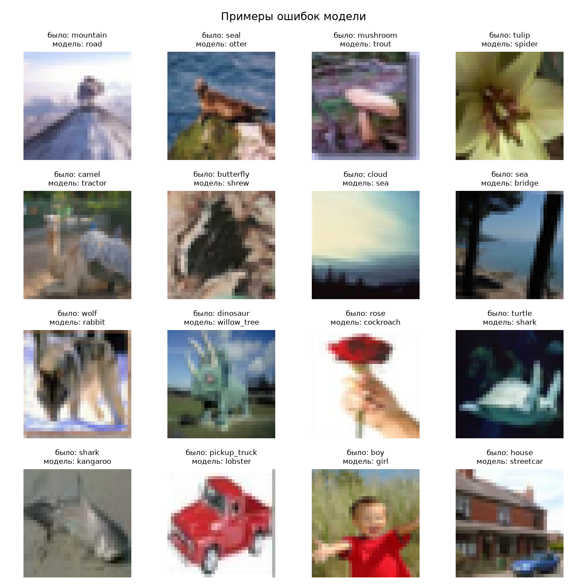

# CIFAR-100 Classifier

Классификация изображений из набора CIFAR-100 (100 классов, картинки 32×32) на PyTorch.
Проект сделан с нуля: загрузка данных, две модели, обучение, оценка и предсказание на своих фото.

## Результаты

| Модель | Top-1 accuracy | Top-5 accuracy |
|---|---|---|
| SimpleCNN (20 эпох, CPU) | 63.65% | 88.62% |
| SmallResNet (30 эпох, GPU T4) | **73.97%** | **93.07%** |

Случайное угадывание дало бы 1%.

### SimpleCNN



Точность на обучении и на тесте почти совпадает, значит, сильного переобучения нет.



Лучше всего модель узнаёт предметы с чёткой формой или цветом (road, motorcycle, sunflower).
Хуже всего: lizard, otter, seal, girl, man.



Модель путает визуально похожие классы:
- люди разного возраста и пола (girl → woman, boy → baby)
- деревья (maple_tree → oak_tree)
- морские животные (seal → otter, ray → shark)

### SmallResNet

SmallResNet точнее SimpleCNN примерно на 10 пунктов (73.97% против 63.65% по Top-1),
но заметно переобучается: 97.5% на обучении против 73.9% на тесте.

- Лучшие классы: orange, road, motorcycle, sunflower, wardrobe (92-94%)
- Худшие классы: otter, boy, girl, man, seal (48-52%)
- Типичные ошибки: люди разного возраста и пола (man → boy, girl → woman),
  деревья (maple_tree → oak_tree), похожие предметы (plate → bowl, cloud → sea)

## Структура проекта

```
src/
├── dataset.py       # загрузка данных, нормализация, аугментации
├── model.py         # SimpleCNN и SmallResNet
├── train.py         # обучение
├── evaluate.py      # метрики, графики, анализ ошибок
├── predict.py       # предсказание для своей картинки
└── show_samples.py  # просмотр примеров из датасета
```

## Установка

```bash
git clone https://github.com/om-mmdv/cifar100-classifier.git
cd cifar100-classifier
python -m venv venv
venv\Scripts\activate        # Windows
source venv/bin/activate     # Linux / macOS
pip install -r requirements.txt
```

## Использование

```bash
# Обучение (данные скачаются автоматически)
python -m src.train --model simple --epochs 20
python -m src.train --model resnet --epochs 30   # лучше на GPU

# Оценка
python -m src.evaluate --model simple

# Предсказание для своей картинки
python -m src.predict photo.jpg --model simple
```

Пример вывода `predict`:
```
  1. apple            51.3%
  2. sweet_pepper     48.6%
```

## Как это работает

- **Данные:** 50 000 картинок для обучения, 10 000 для теста. Аугментации (случайная обрезка и отражение) применяются только к обучающим данным.
- **SimpleCNN:** три группы свёрточных блоков (64, 128, 256 фильтров) с BatchNorm, MaxPool и Dropout.
- **SmallResNet:** стартовая свёртка и три группы остаточных блоков (64, 128, 256 фильтров) с обходными связями (skip connections).
- **Обучение:** SGD с momentum, CrossEntropyLoss, косинусное снижение learning rate.

## Ограничения

- Модель знает только 100 классов CIFAR-100. Если показать ей другой предмет, она всё равно выберет один из этих классов.
- Картинки сжимаются до 32×32, поэтому мелкие детали теряются.
- Веса моделей в репозиторий не включены, их можно получить обучением: SimpleCNN около 2,5 часов на процессоре, SmallResNet около 30 минут на GPU T4 в Google Colab.

## Возможные улучшения

- Более сильные аугментации (Cutout, MixUp) и label smoothing против переобучения SmallResNet
- Веб-демо на Gradio